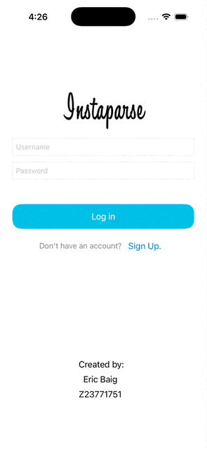

# ios102-lab3-fall26

Submitted by Eric Baig Z23771751

## Description
I went about developing the app by strictly adhering to the instructions on codepath:

- First I set up my project by downloading the Instaparse Pt 2 - Starter Project from codepath. I made sure to add my Back4App Parse server keys in the AppDelegate and also to connect the project to my github.
- Then I started on Step 1B which was to add a unique photo to my photo album. To do this I opened safari, downloaded the FAU logo as a png, then dragged this png from finder into the simulator.
- Next I went on to Step 2 which involved adding some constraints to my query so that I'd only see posts in my feed that were shared less than 24 hours ago and only a maximum of 10. I did this by pasting the new constraints to the query inside of FeedViewController.
- Then I made it to Step 3 which was to to keep a record of when the current user last shared a post, both in the app and in my parse server. This was another copy-and-paste job that took place inside of PostViewController.
- Finally I got to Step 4 which was to make it so that the feed would only show posts shared within 24 hours of the current users last post and otherwise blur out the post images. To do this I added the new blur method inside of PostCell and finished by testing the functionality of the app.

## Features
 The following required features are implemented:
[x] Users are able to to take a photo and upload it to my Parse Server
[x] Users are not able to see other users’ photos until they upload their own.

